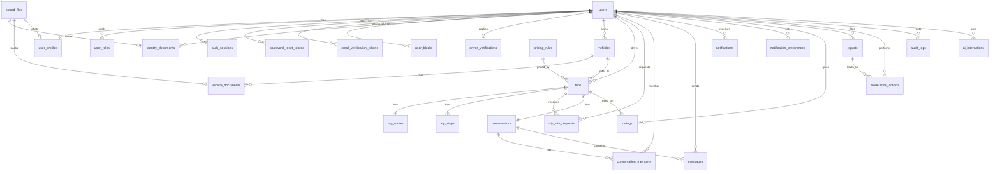

# Database Design

PostgreSQL 16+ with PostGIS 3.4+. Single database, single schema `public` (module ownership is
a code-level contract, see `architecture.md` §2.1). Alembic manages every change.

Conventions:

- Primary keys: `id uuid` (UUID v7, app-generated — ADR-0006).
- Every table: `created_at timestamptz NOT NULL DEFAULT now()`, `updated_at timestamptz NOT NULL`
  (trigger-maintained), except append-only tables (`audit_logs`, `analytics_events`, `messages`
  have `created_at` only where noted).
- Enums: PostgreSQL `ENUM` types named `<table>_<column>_enum`; values are UPPER_SNAKE and match
  `business-rules.md` exactly.
- Money: `bigint` minor units + `char(3)` currency (ADR-0011).
- Geo: `geography(Point, 4326)` for points, `geometry(LineString, 4326)` for route lines,
  `geography(Polygon, 4326)` for corridors (ADR-0012).
- Foreign keys always declare `ON DELETE` behaviour explicitly (§6).
- Soft deletion only where the domain requires history (`users` via status, `vehicles` via status,
  `messages` via `deleted_at` for moderation). No global `deleted_at` convention.

---

## 1. ERD



---

## 2. Tables

Types abbreviated: `uuid`, `text`, `citext`, `bool`, `int`, `bigint`, `tstz` (timestamptz),
`jsonb`, `geog_pt` (`geography(Point,4326)`), `geom_line`, `geog_poly`.

### 2.1 Identity & access (`users`, `auth`)

**users**

| Column | Type | Constraints |
| --- | --- | --- |
| id | uuid | PK |
| email | citext | NOT NULL, UNIQUE — the primary identifier (OD-004 approved) |
| phone_e164 | text | UNIQUE, NULL allowed; CHECK E.164 format; never verified in the MVP |
| password_hash | text | NOT NULL (argon2id) |
| status | enum | `ACTIVE, SUSPENDED, DEACTIVATED, DELETED` |
| email_verified_at | tstz | NULL |
| phone_verified_at | tstz | NULL — stays NULL until an SMS provider is approved |
| identity_verification_status | enum | `NOT_SUBMITTED, PENDING, APPROVED, REJECTED` (denormalised from `identity_documents`) |
| date_of_birth | date | NOT NULL; age ≥ `accounts.minimum_age_years` enforced in the service (OD-021) |
| terms_version / privacy_version | text | NOT NULL — versions accepted at registration (OD-021) |
| legal_accepted_at | tstz | NOT NULL |
| locale | text | `ar`/`en`, default `ar` |
| last_login_at | tstz | |
| deletion_requested_at | tstz | NULL; start of the `accounts.deletion_grace_days` window (OD-020) |
| deleted_at / anonymised_at | tstz | for the OD-020 workflow |

Indexes: `UNIQUE(email)`, `UNIQUE(phone_e164)`, `(status)`,
`(deletion_requested_at) WHERE deletion_requested_at IS NOT NULL` for the anonymisation job.

**user_profiles** (1:1)

| Column | Type | Constraints |
| --- | --- | --- |
| user_id | uuid | PK, FK users ON DELETE CASCADE |
| display_name | text | NOT NULL, 2–60 chars |
| full_name | text | NOT NULL (private) |
| photo_file_id | uuid | FK stored_files ON DELETE SET NULL |
| city | text | NULL |
| bio | text | NULL, ≤ 300 |

**user_roles**

| Column | Type | Constraints |
| --- | --- | --- |
| user_id | uuid | FK users ON DELETE CASCADE |
| role | enum | `PASSENGER, DRIVER, ADMIN` |
| granted_by | uuid | FK users ON DELETE SET NULL (NULL = system) |
| granted_at | tstz | |

PK `(user_id, role)`. `roles`/`permissions` tables are **intentionally absent** (ADR-0005).

**user_blocks**: `blocker_id`, `blocked_id` (FK users CASCADE), `created_at`. PK `(blocker_id,
blocked_id)`, CHECK `blocker_id <> blocked_id`, index `(blocked_id)`.

**auth_sessions**

| Column | Type | Constraints |
| --- | --- | --- |
| id | uuid | PK (session id) |
| user_id | uuid | FK users CASCADE |
| refresh_token_hash | text | UNIQUE (SHA-256 of opaque token) |
| family_id | uuid | rotation family for reuse detection |
| user_agent, ip_hash | text | user agent truncated; IP stored only as a keyed hash |
| expires_at | tstz | NOT NULL — sliding window, extended on rotation |
| absolute_expires_at | tstz | NOT NULL — hard cap for the family (`auth.refresh_absolute_ttl_days`) |
| revoked_at | tstz | NULL |
| revoked_reason | enum | NULL; `LOGOUT, ROTATED, REUSE_DETECTED, PASSWORD_CHANGED, PASSWORD_RESET, USER_REVOKED, ACCOUNT_CLOSED` |
| last_used_at | tstz | |

Indexes: `(user_id) WHERE revoked_at IS NULL`, `(expires_at)`, `(family_id)`.

**password_reset_tokens** / **email_verification_tokens**: `id`, `user_id` FK CASCADE,
`token_hash` UNIQUE, `expires_at`, `used_at`. Index `(user_id)`.

### 2.2 Verification & vehicles

**stored_files**

| Column | Type | Constraints |
| --- | --- | --- |
| id | uuid | PK |
| bucket | enum | `PUBLIC_MEDIA, PRIVATE_DOCUMENTS` |
| object_key | text | UNIQUE, server-generated |
| owner_user_id | uuid | FK users ON DELETE RESTRICT (deleted via retention job first) |
| mime_type, byte_size, sha256 | text/bigint/text | validated at upload |
| original_name | text | sanitised, display only |
| scan_status | enum | `NOT_SCANNED, CLEAN, INFECTED, SCAN_UNAVAILABLE` (see security.md §3) |
| purge_after | tstz | NULL; set to decision time + `verification.document_retention_days` (OD-009 approved) |
| purged_at | tstz | |

**identity_documents**

| Column | Type | Constraints |
| --- | --- | --- |
| id | uuid | PK |
| user_id | uuid | FK users CASCADE |
| document_type | enum | `NATIONAL_ID_FRONT, NATIONAL_ID_BACK, SELFIE` (OD-002 approved) |
| file_id | uuid | FK stored_files RESTRICT |
| status | enum | `PENDING, APPROVED, REJECTED` |
| reviewed_by | uuid | FK users SET NULL |
| reviewed_at | tstz | |
| rejection_reason | text | CHECK required when REJECTED |

Indexes: `(user_id)`, `(status, created_at)` for the admin queue.

**driver_verifications** (one active per user)

| Column | Type | Constraints |
| --- | --- | --- |
| id | uuid | PK |
| user_id | uuid | FK users CASCADE |
| status | enum | `PENDING, APPROVED, REJECTED, REVOKED` |
| licence_file_id | uuid | FK stored_files RESTRICT |
| licence_expires_on | date | |
| reviewed_by / reviewed_at / rejection_reason | | as above |

Partial unique: `(user_id) WHERE status IN ('PENDING','APPROVED')`.

**vehicles**

| Column | Type | Constraints |
| --- | --- | --- |
| id | uuid | PK |
| owner_user_id | uuid | FK users CASCADE |
| make, model | text | NOT NULL |
| year | int | CHECK 1980 ≤ year ≤ current+1 |
| color | text | NOT NULL |
| vehicle_type | enum | `SEDAN, HATCHBACK, SUV, VAN, MINIBUS, OTHER` |
| seat_capacity | int | CHECK 2 ≤ seat_capacity ≤ 20 (incl. driver) |
| plate_number | text | NOT NULL, normalised; visibility BR-VEH-02 (OD-022 approved) |
| status | enum | `ACTIVE, INACTIVE` |
| verification_status | enum | `PENDING, APPROVED, REJECTED` |

Indexes: `(owner_user_id)`, `(verification_status) WHERE verification_status = 'PENDING'`.

**vehicle_documents**: `id`, `vehicle_id` FK CASCADE, `document_type` enum (`REGISTRATION_FRONT`, `REGISTRATION_BACK`, `VEHICLE_PHOTO`; OD-024 approved),
`file_id` FK stored_files RESTRICT, `status`, review columns. Index `(vehicle_id)`.

### 2.3 Trips

**trips**

| Column | Type | Constraints |
| --- | --- | --- |
| id | uuid | PK |
| driver_id | uuid | FK users RESTRICT |
| vehicle_id | uuid | FK vehicles RESTRICT |
| status | enum | `DRAFT, PUBLISHED, FULL, IN_PROGRESS, COMPLETED, CANCELLED, EXPIRED` |
| departure_at | tstz | NOT NULL |
| estimated_arrival_at | tstz | CHECK > departure_at |
| total_seats | int | CHECK 1 ≤ total_seats |
| available_seats | int | **CHECK 0 ≤ available_seats ≤ total_seats** |
| origin_label, destination_label | text | display names |
| origin_point, destination_point | geog_pt | denormalised from stops for fast filtering |
| origin_area_point, destination_area_point | geog_pt | blurred points for public display (BR-TRIP-10) |
| pricing_rule_id | uuid | FK pricing_rules RESTRICT |
| price_per_seat_minor, platform_fee_minor, driver_amount_minor | bigint | snapshot (BR-PRICE-04) |
| currency | char(3) | `EGP` |
| notes | text | ≤ 500 |
| version | int | optimistic-lock counter for edits |
| published_at, started_at, completed_at, cancelled_at, expired_at | tstz | |
| cancelled_by | enum | `DRIVER, ADMIN, SYSTEM` |
| cancel_reason | text | |

Indexes (query patterns from search, dashboards, jobs):

| Index | Purpose |
| --- | --- |
| `(status, departure_at)` | search candidates, expiry job |
| `(driver_id, departure_at DESC)` | driver's trips |
| `GIST (origin_point)`, `GIST (destination_point)` | coarse pre-filter |
| `(departure_at) WHERE status IN ('PUBLISHED','FULL')` | starting-soon job |

**trip_routes** (1:1)

| Column | Type | Constraints |
| --- | --- | --- |
| trip_id | uuid | PK, FK trips CASCADE |
| geometry | geom_line | NOT NULL, SRID 4326 |
| corridor | geog_poly | NOT NULL — `ST_Buffer(geometry::geography, matching.corridor_width_meters)` precomputed at publish |
| distance_m | int | NOT NULL |
| duration_s | int | NOT NULL |
| provider, provider_ref | text | which map provider produced it |
| computed_at | tstz | |

Indexes: `GIST (corridor)` — the core matching index (`ST_Covers(corridor, pickup)`);
`GIST (geometry)` for `ST_LineLocatePoint` ordering.

**trip_stops**

| Column | Type | Constraints |
| --- | --- | --- |
| id | uuid | PK |
| trip_id | uuid | FK trips CASCADE |
| sequence | int | UNIQUE with trip_id |
| kind | enum | `ORIGIN, WAYPOINT, DESTINATION` |
| label | text | |
| point | geog_pt | NOT NULL |
| route_fraction | numeric(6,5) | position along route (0..1) |

### 2.4 Bookings

**trip_join_requests**

| Column | Type | Constraints |
| --- | --- | --- |
| id | uuid | PK |
| trip_id | uuid | FK trips RESTRICT |
| passenger_id | uuid | FK users RESTRICT |
| status | enum | `PENDING, ACCEPTED, REJECTED, CANCELLED, EXPIRED, COMPLETED` |
| seats_requested | int | CHECK ≥ 1 |
| pickup_point, dropoff_point | geog_pt | NOT NULL |
| pickup_label, dropoff_label | text | |
| pickup_fraction, dropoff_fraction | numeric(6,5) | CHECK pickup < dropoff (BR-MATCH-02) |
| note | text | ≤ 300 |
| idempotency_key | text | NOT NULL |
| responded_at, cancelled_at | tstz | |
| cancelled_by | enum | `PASSENGER, DRIVER, ADMIN, SYSTEM` |
| cancel_reason | text | |
| minutes_before_departure_at_cancel | int | recorded for ⛔ OD-008 |

Constraints & indexes:

| Definition | Rule |
| --- | --- |
| `UNIQUE (trip_id, passenger_id) WHERE status IN ('PENDING','ACCEPTED')` | BR-JOIN-03 |
| `UNIQUE (passenger_id, idempotency_key)` | BR-JOIN-05 |
| `(trip_id, status)` | driver's request list |
| `(passenger_id, created_at DESC)` | passenger's requests |
| `(status, created_at) WHERE status = 'PENDING'` | expiry job |

`trip_passengers` is **intentionally absent**: an `ACCEPTED`/`COMPLETED` join request *is* the
passenger record; a second table would duplicate state (MEP §6 DRY).

### 2.5 Chat

**conversations**: `id`, `type` enum `TRIP` (`COMMUNITY` added only if ⛔ OD-015 approves),
`trip_id` FK trips CASCADE UNIQUE (NULL for non-trip types), `is_read_only bool`, timestamps.

**conversation_members**: `conversation_id` FK CASCADE, `user_id` FK CASCADE, `joined_at`,
`left_at` NULL, `last_read_message_id` uuid NULL, `muted bool`. PK `(conversation_id, user_id)`;
index `(user_id) WHERE left_at IS NULL`.

**messages**

| Column | Type | Constraints |
| --- | --- | --- |
| id | uuid | PK (v7 ⇒ time-ordered; used as cursor) |
| conversation_id | uuid | FK CASCADE |
| sender_id | uuid | FK users SET NULL; NULL for SYSTEM |
| kind | enum | `TEXT, SYSTEM` |
| body | text | CHECK 1 ≤ length ≤ 2000 |
| system_event | text | NULL unless kind = SYSTEM |
| client_message_id | uuid | for de-duplication; `UNIQUE (sender_id, client_message_id)` |
| deleted_at, deleted_by | tstz/uuid | moderation soft delete |
| created_at | tstz | |

Index: `(conversation_id, id DESC)` — keyset pagination. Read status is derived from
`conversation_members.last_read_message_id` (no per-message-per-user table — MEP §18 "basic").

### 2.6 Notifications

**notifications**: `id`, `user_id` FK CASCADE, `type` enum (`JOIN_REQUEST_RECEIVED,
JOIN_REQUEST_ACCEPTED, JOIN_REQUEST_REJECTED, TRIP_UPDATED, TRIP_CANCELLED, NEW_MESSAGE,
TRIP_STARTING_SOON, VERIFICATION_STATUS_CHANGED, REPORT_UPDATED`), `payload jsonb` (ids only,
no PII), `read_at`, `email_sent_at`, `created_at`. Index `(user_id, created_at DESC)`,
`(user_id) WHERE read_at IS NULL`.

**notification_preferences**: `user_id` FK CASCADE, `type` enum, `channel` enum `IN_APP, EMAIL`
(`PUSH`, `SMS` reserved), `enabled bool`. PK `(user_id, type, channel)`.

### 2.7 Ratings, safety, moderation

**ratings**: `id`, `trip_id` FK RESTRICT, `rater_id` FK RESTRICT, `ratee_id` FK RESTRICT,
`overall smallint CHECK 1..5`, dimension columns ⛔ OD-016 (`punctuality`, `communication`,
`experience` smallint NULL), `comment text ≤ 500`, `created_at`.
`UNIQUE (trip_id, rater_id, ratee_id)`, CHECK `rater_id <> ratee_id`, index `(ratee_id)`.

**reports**: `id`, `reporter_id` FK RESTRICT, `target_type` enum `USER, TRIP, MESSAGE`,
`target_id uuid`, `reason` enum (`SAFETY, HARASSMENT, SPAM, NO_SHOW, FRAUD, OTHER`),
`description ≤ 1000`, `status` enum `OPEN, UNDER_REVIEW, RESOLVED, DISMISSED`, `resolved_by`,
`resolved_at`, `resolution_notes`. `UNIQUE (reporter_id, target_type, target_id) WHERE status IN
('OPEN','UNDER_REVIEW')`; index `(status, created_at)`, `(target_type, target_id)`.

**moderation_actions**: `id`, `report_id` FK SET NULL, `actor_id` FK RESTRICT, `target_user_id`
FK RESTRICT, `action` enum `WARN, REMOVE_CONTENT, SUSPEND_USER, RESTORE_USER, CANCEL_TRIP,
REVOKE_DRIVER`, `reason text NOT NULL`, `metadata jsonb`, `created_at`. Index `(target_user_id)`.

### 2.8 Pricing

**pricing_rules**: `id`, `name`, `currency char(3)`, `base_fee_minor bigint`, `per_km_minor
bigint`, `platform_fee_bps int CHECK 0..10000`, `effective_from tstz`, `effective_to tstz NULL`,
`created_by`. `EXCLUDE USING gist (tstzrange(effective_from, effective_to) WITH &&)` guarantees
one active rule at any instant (BR-PRICE-02). `payment_records` and `subscriptions` are **not
created** (MEP §31/§33).

### 2.9 Audit & platform

**audit_logs** (append-only)

| Column | Type |
| --- | --- |
| id | uuid |
| actor_type | enum `USER, ADMIN, SYSTEM` |
| actor_id | uuid NULL |
| action | text (enumerated in `security.md` §9) |
| target_type, target_id | text, uuid |
| metadata | jsonb (no PII, no document contents) |
| request_id | text |
| ip_hash | text |
| created_at | tstz |

Indexes: `(created_at DESC)`, `(actor_id, created_at DESC)`, `(target_type, target_id)`.
The application role is granted `INSERT, SELECT` only (BR-SAFE-05). Monthly partitioning
by `created_at` is planned for Phase 11 if volume warrants.

**feature_flags**: `key text PK`, `enabled bool`, `description`, `rules jsonb` (e.g. role
allow-list), `updated_by`. **app_settings**: `key text PK`, `value jsonb`, `updated_by` — holds
the admin-editable configuration keys from `business-rules.md` §10.

**analytics_events**: `id`, `event_name` enum (PRD §8 list), `user_id` FK SET NULL, `properties
jsonb` (ids/booleans only), `created_at`. Index `(event_name, created_at)`.

**ai_interactions**: `id`, `user_id` FK SET NULL, `prompt_hash`, `tool_calls jsonb`,
`outcome` enum `ANSWERED, REFUSED, ERROR`, `latency_ms`, `created_at`. Index `(user_id,
created_at DESC)`.

---

## 3. Seat consistency at the database level

1. `trips.available_seats` CHECK `0 ≤ available_seats ≤ total_seats` — makes overbooking a
   constraint violation even if application code is wrong.
2. Every seat change runs `SELECT … FOR UPDATE` on the trip row first (BR-JOIN-06/07),
   serialising concurrent accepts/cancels for the same trip.
3. Partial unique index prevents duplicate active requests (BR-JOIN-03).
4. `UNIQUE (passenger_id, idempotency_key)` makes retried creates return the same request.
5. Status transitions are guarded by `UPDATE … WHERE status = '<expected>'` and checked row
   counts — a lost race yields `REQUEST_NOT_PENDING`, never a silent success.

## 4. Geographic queries

Candidate trip matching (BR-MATCH-01/02) in one query:

```sql
SELECT t.id, ST_Distance(r.geometry::geography, :pickup) AS pickup_d,
       ST_Distance(r.geometry::geography, :dropoff) AS dropoff_d,
       ST_LineLocatePoint(r.geometry, ST_GeomFromEWKB(:pickup))  AS pf,
       ST_LineLocatePoint(r.geometry, ST_GeomFromEWKB(:dropoff)) AS df
FROM trips t JOIN trip_routes r ON r.trip_id = t.id
WHERE t.status = 'PUBLISHED'
  AND t.available_seats >= :seats
  AND t.departure_at BETWEEN :t_from AND :t_to
  AND ST_Covers(r.corridor, :pickup) AND ST_Covers(r.corridor, :dropoff)
  AND ST_LineLocatePoint(r.geometry, :pickup_geom) < ST_LineLocatePoint(r.geometry, :dropoff_geom)
  AND NOT EXISTS (SELECT 1 FROM user_blocks b WHERE (b.blocker_id = t.driver_id AND b.blocked_id = :me)
                                                 OR (b.blocker_id = :me AND b.blocked_id = t.driver_id))
ORDER BY (pickup_d + dropoff_d), abs(extract(epoch from t.departure_at - :t_req)), t.available_seats DESC, t.departure_at, t.id
```

The corridor is precomputed at publish so the GiST index on `corridor` does the heavy lifting;
`ST_LineLocatePoint` runs only on survivors of the index filter. Corridor width changes
(⛔ OD-006) require a re-buffer job — documented in `runbooks/` when implemented.

## 5. Migrations

- Alembic, one revision per change, descriptive slug (`0007_add_trip_routes`).
- Autogenerate is a starting point; every revision is hand-reviewed; PostGIS objects and
  partial/exclusion indexes are written explicitly.
- `downgrade()` implemented unless destructive data loss makes it impractical, in which case the
  revision docstring says so and the PR states the rollback plan.
- CI runs `upgrade head`, `downgrade base`, `upgrade head` against a fresh PostGIS container, and
  fails on model/migration drift (`alembic check`).
- Production: migrations run as a dedicated release step before new API instances start; never
  edited by hand (MEP §44).

## 6. Delete behaviour policy

| Relationship | Behaviour | Why |
| --- | --- | --- |
| user → sessions, tokens, roles, blocks, profile, preferences, notifications | CASCADE | pure ownership, no history value |
| user → trips, join_requests, ratings, reports, moderation_actions, audit_logs | RESTRICT | history must survive; users are anonymised, not deleted (BR-ACC-07) |
| trip → routes, stops, conversation | CASCADE | trips are never hard-deleted in practice (status is terminal); cascade keeps test cleanup simple |
| stored_files ← documents | RESTRICT | files are purged by the retention job after the referencing row is handled |
| reviewed_by / granted_by / sender_id | SET NULL | attribution may disappear, record must not |

## 7. Anonymisation design (mechanism; policy approved — BR-ACC-07)

`users.status = DELETED`, `anonymised_at` set, `email`/`phone_e164`/`password_hash` replaced by
irreversible placeholders, `user_profiles` display name → "Deleted user", photo unlinked,
`stored_files` for that user scheduled for purge, sessions revoked. Trips, requests, ratings,
messages remain referentially intact with the anonymised author. Audit logs are never altered.

## 8. Roles at the database level

| DB role | Grants |
| --- | --- |
| `fisikkati_migrator` | DDL (used only by the migration step) |
| `fisikkati_app` | DML on all tables; `INSERT, SELECT` only on `audit_logs`; no DDL |
| `fisikkati_readonly` | SELECT for analytics/support tooling; excluded from `stored_files.object_key`, tokens via column grants |
